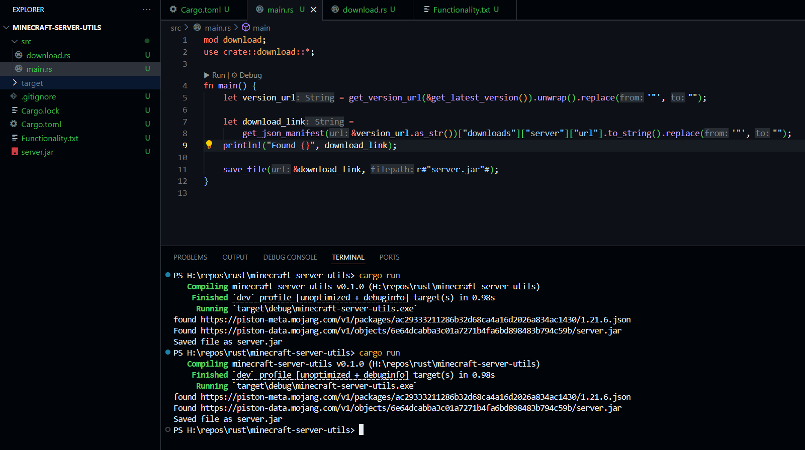

3h 37m • 2025/06/18 17:43 [^1]

Added basic download functionality for vanilla Minecraft server.jar files. Program searches the Minecraft version manifest for a specified version, then downloads and saves the server.jar from the link.

[^1]: Based on image name. I don't know for *sure* when I posted this.
