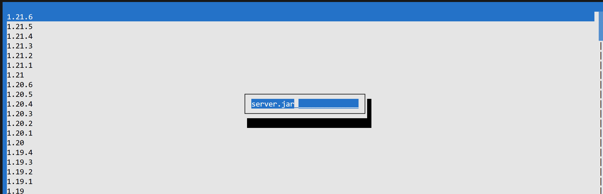

2h 54m • 2025/06/22 06:13 [^1]

Spent an absurdly long time trying to pass the version index to the save file dialog so that the file can be saved with a specific filename

[^1]: Based on image name. I don't know for *sure* when I posted this.
